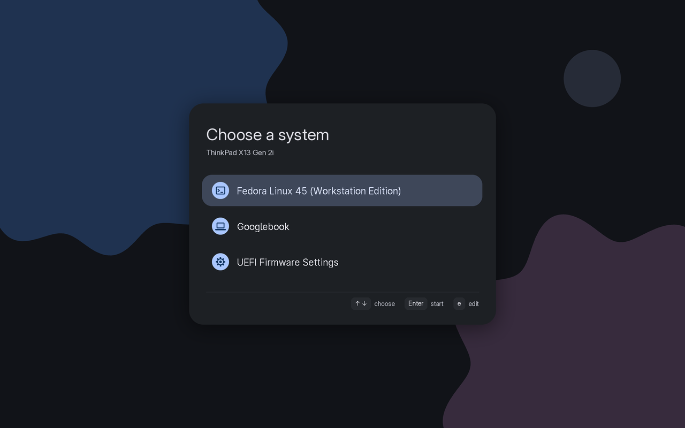

# Personal Googlebook x86-64 script for ThinkPad X13 Gen 2i

My own additions for running Googlebook OS (Google's Android 17 desktop, device `lapis`) on a **ThinkPad X13 Gen 2i**
(20WL, Intel i5-1145G7 / Iris Xe, 16 GB, Synaptics 06cb:00f9 fingerprint reader) through
[gbOS86](https://github.com/linuxkid473/gbos-x86). Personal use only.

This repo holds **only my own files**. gbos-x86 itself is not copied here: `apply.sh` puts these files onto a gbos-x86
checkout and applies `patches/gbos-x86-changes.patch` to the few upstream files they hook into.
Base: upstream `729b9c3` (kernel #42 `6.18.21-gbos-whl`, module tree r5, release v40).

## What it does

| | | Details |
|---|---|---|
| **Lenovo identity** | Settings shows *ThinkPad X13 Gen 2i* / *LENOVO* instead of *ASUS Googlebook 14*; the build fingerprint stays Google's ASUS one | [docs/identity.md](docs/identity.md) |
| **Fingerprint reader** | A new `IFingerprint` HAL for the Synaptics match-on-chip sensor: enroll, unlock, lockout (WEAK class) | [docs/fingerprint.md](docs/fingerprint.md) |
| **Boot menu** | Fedora's GRUB as a Material 3 menu for Fedora and Googlebook | [docs/grub.md](docs/grub.md) |
| **Quiet, fast boot** | 67.6 s → 29.2 s to `boot_completed`; no kernel text from power-on to the Googlebook animation, none at shutdown | [docs/boot.md](docs/boot.md) |
| **Dual boot beside Fedora** | Googlebook on the internal NVMe next to Fedora, own boot entry | [docs/install-internal.md](docs/install-internal.md) |
| **Googlebook VM** | The installed Googlebook in a QEMU/KVM window from Fedora, as a throwaway snapshot, for testing apps; app-menu launcher, screen kept on, CPU drawing | [docs/vm.md](docs/vm.md) |
| **GPU-accelerated VM** (work in progress) | Venus driver built and loading; drawing blocked by buffer sharing, so the VM stays CPU-drawn | [vm-gpu/README.md](vm-gpu/README.md) |
| **adb** | Over Wi-Fi, a Thunderbolt cable or the VM (USB-cable debugging: see notes) | [docs/adb.md](docs/adb.md) |
| **Extra kernel modules** | `thunderbolt_net`, `virtio-gpu`, `virtio_dma_buf` built for the shipped kernel without rebuilding it | [docs/kernel-modules.md](docs/kernel-modules.md) |

## How this laptop is set up



*The boot menu: Fedora's GRUB with the `googlebook-m3` Material 3 theme ([docs/grub.md](docs/grub.md)).*

| Boot entry (F12) | What it boots |
|---|---|
| `Boot0001` Fedora (default) | GRUB → Fedora on `nvme0n1p3` (btrfs, 163.9 GiB) or Googlebook ([docs/grub.md](docs/grub.md)) |
| `Boot0000` **Googlebook** | `EFI/gbos/BOOTX64.EFI` on Fedora's EFI partition + `nvme0n1p4` GBOSSYS (8 GiB), `p5` GBOS_META, `p6` GBOS_DATA (63.9 GiB) |

The external 128 GB SSD (Lexar E6) holds the first install: now a backup and a VM source, no longer a boot entry
(`tools/grub/install_grub.sh` step 6 removes it and renames "Googlebook (internal)" to "Googlebook").

> **The SSD and the internal install carry the same partition labels** (`GBOSSYS`, `GBOS_META`, `GBOS_DATA`) and gbOS86
> finds its partitions by label. Boot Googlebook with the SSD **unplugged**; do not boot the SSD itself while the internal
> install exists (it could mix the two). [docs/install-internal.md](docs/install-internal.md#the-external-ssd-now) has the details.

The firmware entry and the GRUB entry both start Googlebook with `quiet loglevel=1 printk.ignore_loglevel=0
vt.global_cursor_default=0 console=ttynull` (see [docs/boot.md](docs/boot.md)).

## Everyday

| Task | How |
|---|---|
| Boot Googlebook | Pick *Googlebook* in the GRUB menu (or **F12** → *Googlebook*) |
| Test an app in a VM (from Fedora) | App menu → **Googlebook VM** (or `sh ~/Documents/gbos-x86/tools/run_vm.sh`), then `adb connect 127.0.0.1:5556` |
| adb over Wi-Fi | USB debugging on in Developer options, then `adb connect <googlebook-ip>:5555` |
| Change a boot option | `gbos/gbos.cfg` on the GBOSSYS partition ([below](#boot-options-gboscfg)) |
| Boot logs | `gbos/logs/boot-N/` on GBOSSYS (`kmsg.log`, `crash.txt`, `hw.txt`, `hwdetect.txt`) |
| Show the boot text again | `QUIET_BOOT=0` in `gbos.cfg` |
| Full logs for one boot | `DEBUG_LOGS=1` in `gbos.cfg` |

The internal GBOSSYS is not mounted in Fedora. To edit it:
```sh
sudo mount -o uid=$(id -u) /dev/nvme0n1p4 /mnt && nano /mnt/gbos/gbos.cfg; sudo umount /mnt
```

### Boot options (`gbos.cfg`)
Mine (the rest are gbOS86's own and documented in the file):

| Option | Value here | Meaning |
|---|---|---|
| `DEVICE_BRAND`, `DEVICE_MODEL` | `LENOVO`, `ThinkPad X13 Gen 2i` | Brand/model in all seven partitions' build.prop |
| `LOAD_I915` | `0` | stage0's `modprobe i915` only failed here and cost a 2 s pause; hwdetect loads the driver |
| `FINGERPRINT` | (1) | `0` turns the fingerprint HAL off |
| `TB_NET`, `TB_NET_IP` | (1), `10.42.0.2` | Thunderbolt network link for adb |
| `QUIET_BOOT` | (1) | `0` shows the kernel/init text again |
| `DEBUG_LOGS` | (0) | `1`: full logcat, KMS debug, audio/display/AI diagnostics |
| `KVM_TRACE` | (0) | `1`: trace every exit of the Trusty VM (~30 MB per boot) |

### App launcher


**Googlebook VM** in the app menu runs `tools/run_vm.sh` with no terminal: one GNOME authorization dialog (fingerprint or
password), then the VM window; errors show as notifications. Install or reinstall it with:
```sh
sh ~/Documents/gbos-x86/tools/launcher/install_launcher.sh
```
It installs the icon in this repo (`tools/launcher/googlebook-vm.png`: a flat laptop with the
[Aluminium OS wallpaper](https://4kwallpapers.com/images/wallpapers/aluminium-os-stock-3636x3636-26364.jpeg) on its screen).
Installed files: `~/.local/share/applications/googlebook-vm.desktop` and `~/.local/share/googlebook-vm/googlebook-vm.png`.

## Repo layout

| Path | What |
|---|---|
| `apply.sh` | Puts this repo onto a gbos-x86 checkout (copies the files, `git apply --3way` the patch) |
| `patches/gbos-x86-changes.patch` | My changes to upstream files: `usb/hook.sh`, `usb/gbos.cfg`, `usb/install.sh`, image/deploy scripts, a test, README |
| `fingerprint/` | `gbos_fp.c` (the HAL), `syn.h` (sensor protocol), `syn_test.c`, `build.sh` |
| `usb/gbos_fp`, `usb/tbnet.sh`, `usb/quiet_boot.sh` | Built HAL, Thunderbolt network script, quiet boot |
| `usb/kmod/*.ko` | `thunderbolt_net`, `virtio_dma_buf`, `virtio-gpu` for kernel #42 |
| `kernel/` | `build_extra_module.sh`, `symvers_from_modules.py`, `virtio-gpu-dumb-rgba.patch` |
| `tools/install_internal.sh` | Dual boot beside Fedora (dry run by default) |
| `tools/run_vm.sh` | Googlebook VM snapshot |
| `tools/grub/` | `make_theme.py` (the googlebook-m3 theme), `googlebook-m3/` (generated), `install_grub.sh` |
| `tools/launcher/` | `install_launcher.sh` (the "Googlebook VM" app launcher) and its icon `googlebook-vm.png` |
| `vm-gpu/` | GPU-accelerated VM work: pinned Mesa/NDK, `fetch.sh`, `build_venus.sh`, `test_boot.sh` (`GPU=cpu` for the normal VM) |
| `tools/test_*.sh` | Checks: fingerprint wiring, Thunderbolt module, identity rewrite, quiet/fast boot |

## Installation guide
From a fresh start to Googlebook beside Fedora on a ThinkPad X13 Gen 2i, the way this laptop was set up. Every step that
writes to a disk or the firmware asks first; the scripts default to a dry run.

### 0. What you need
- **Fedora** on the internal NVMe, `/` on btrfs as the disk's last partition, at least ~72 GiB free (Googlebook gets 72 GiB;
  Fedora must keep 20 GiB free after the shrink). **Back up Fedora first.**
- **Secure Boot off** (BIOS Setup → Security): the gbOS86 kernel is not signed.
- An **external drive of 64 GB or more** (USB or Thunderbolt SSD) for the first install; it becomes the copy source and a
  backup. Everything on it is erased when it is flashed.
- On Fedora: `git`, `docker` (gbos-x86's builds run in containers), `qemu-system-x86` + `edk2-ovmf` (only for the VM),
  `grub2-tools` (already there); `python3-pillow` only to regenerate the GRUB theme.

### 1. Get the sources and apply this repo
```sh
git clone https://github.com/zakkyhidayat/gbos-x86-personal ~/Documents/gbos-x13g2   # this repo (private)
git clone https://github.com/linuxkid473/gbos-x86 ~/Documents/gbos-x86
git -C ~/Documents/gbos-x86 checkout 729b9c3                                          # the base this repo is made for
sh ~/Documents/gbos-x13g2/apply.sh ~/Documents/gbos-x86
cd ~/Documents/gbos-x86
sh tools/test_gbos_fp.sh && sh tools/test_tbnet.sh && sh tools/test_device_model.sh && sh tools/test_boot_quiet.sh
```
All four tests must pass. If `test_tbnet.sh` fails on vermagic or CRCs, upstream's kernel differs: see
[docs/kernel-modules.md](docs/kernel-modules.md#rebuilding-for-a-new-kernel).

### 2. Build the image and flash the external drive
```sh
./build.sh --looper --data-size 32                  # dist/gbOS86-looper-*.img, ~41 GB (downloads Google's image on the first run)
lsblk -o NAME,SIZE,MODEL,TRAN                       # find the external drive, e.g. /dev/sda (NOT nvme0n1)
sudo dd if=dist/gbOS86-looper-*.img of=/dev/sdX bs=4M status=progress conv=fsync
```
Double-check the device name: `dd` overwrites it completely. The data size only matters for running from the external drive;
the internal install starts with its own empty `/data`. Optional: boot it once (F12 → the USB drive) to see Googlebook
run before touching the internal disk.

### 3. Install beside Fedora
With the external drive plugged in (it is only read):
```sh
sh tools/install_internal.sh          # dry run: shows the layout computed from your disk and every command
sh tools/install_internal.sh --run    # asks before each step: y continues, anything else stops
```
It shrinks Fedora's btrfs and partition, adds GBOSSYS / GBOS_META / GBOS_DATA, copies the system from the external drive
(compared file by file), puts the kernel in `EFI/gbos/` on Fedora's EFI partition and adds the "Googlebook (internal)"
firmware entry with the quiet options. Details and recovery: [docs/install-internal.md](docs/install-internal.md).

### 4. First boot
1. **Unplug the external drive** (both disks carry the same labels).
2. Restart, **F12** → *Googlebook (internal)*.
3. Googlebook's setup runs (fresh `/data`): sign in, set a lock-screen PIN or password (needed for the fingerprint), then
   Settings → Security → Fingerprint. During enrollment, lift and move the finger slightly between touches.
4. Settings → About should show **ThinkPad X13 Gen 2i / LENOVO**.

### 5. Optional extras
| What | Command | Docs |
|---|---|---|
| Material 3 GRUB menu with Fedora and Googlebook; removes the external drive's entry and renames the internal one "Googlebook" | `sh tools/grub/install_grub.sh` then `--run` | [docs/grub.md](docs/grub.md) |
| "Googlebook VM" app launcher (test apps from Fedora) | `sh tools/launcher/install_launcher.sh` | [docs/vm.md](docs/vm.md) |
| adb over Wi-Fi | Developer options → USB debugging, then `adb connect <ip>:5555` | [docs/adb.md](docs/adb.md) |

### Undo
- GRUB menu: [docs/grub.md](docs/grub.md#undo).
- Googlebook on the internal disk: [docs/install-internal.md](docs/install-internal.md#removing-it) (deletes its data and
  gives the space back to Fedora).

## After a newer gbos-x86
1. Apply on a fresh checkout. `apply.sh` uses `git apply --3way`, so conflicts show as markers instead of failing silently.
2. Run the four tests. If `test_tbnet.sh` fails on vermagic or CRCs, upstream shipped a new kernel: rebuild the three
   modules ([docs/kernel-modules.md](docs/kernel-modules.md#rebuilding-for-a-new-kernel)).
3. `gbos_fp` only uses stable NDK interfaces and normally survives; rebuild it with `fingerprint/build.sh` if needed.
4. Copy the result to the internal install ([docs/install-internal.md](docs/install-internal.md#updating)).

## Status

| | |
|---|---|
| Boot on kernel #42 (#37 panicked on Tiger Lake) | works |
| Settings > About: ThinkPad X13 Gen 2i, LENOVO | works |
| Fingerprint enrollment in Settings | works (3 fingers on the SSD install, 3 on the internal one after one failed try) |
| Lock-screen unlock with a fingerprint | not checked yet |
| Boot time 67.6 s → 29.2 s; boot entry with `quiet` hides the kernel text | works |
| `console=ttynull` hides stage0's own messages | not checked yet |
| Two crash loops stopped (`timberslide`, `suspend_diagnostics`) | in place, not re-measured |
| `thunderbolt_net` loads; adb over a Thunderbolt cable | loads; cable not checked |
| Googlebook VM: external SSD, colours, mouse | works |
| Googlebook VM: screen stays on (no more "Display output is not active" after idling) | works (UI still shown after 4 min idle) |
| Googlebook VM with GPU drawing (Venus) | driver loads and reaches the host GPU; screen buffers cannot be shared yet |
| Googlebook VM: internal install (`--internal`) | ran on the real partitions, exited cleanly |
| "Googlebook VM" app launcher (no terminal: one polkit prompt, then the VM) | works |
| Internal dual boot beside Fedora | works (first boot: setup, 3 fingers enrolled) |
| GRUB menu with the Material 3 theme | installed (`grub.cfg` has the entry and theme); first boot with it not seen yet |
| Firmware entries: Fedora, Googlebook (SSD's removed) | done |
| Build fingerprint stays ASUS | fixed in `hook.sh` (was LENOVO); confirmed in a VM boot of the internal install's files: Android reports `ASUS/lapis/...` ([docs/identity.md](docs/identity.md#build-fingerprint)) |

## Credits and licences
- [linuxkid473/gbos-x86](https://github.com/linuxkid473/gbos-x86) (gbOS86): everything this builds on.
- [libfprint](https://gitlab.freedesktop.org/libfprint/libfprint): the Synaptics protocol ported in `fingerprint/syn.h`
  (LGPL-2.1-or-later, as is `syn_test.c`). `gbos_fp.c` is Apache-2.0. The kernel modules and `virtio-gpu-dumb-rgba.patch` are GPL-2.0 (Linux).
- [vthonte/gbos86-persistent-dualboot](https://github.com/vthonte/gbos86-persistent-dualboot): the idea of turning off
  `timberslide` and the `suspend_notification_service` / `suspend_diagnostics` loop on non-Chromebook hardware.
- [chaitan3/gbos-vm-linux](https://github.com/chaitan3/gbos-vm-linux): reference for GPU-accelerated VMs (not used).
